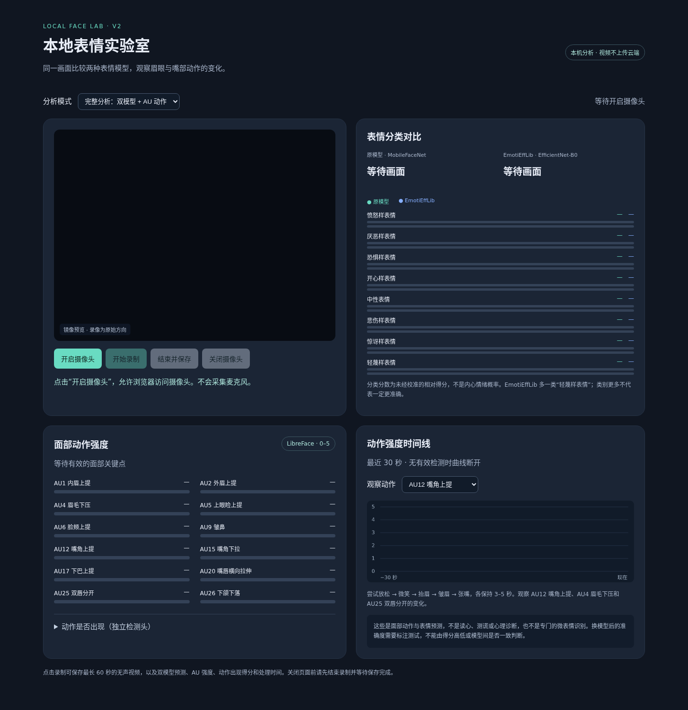

# Local Face Lab · 本地表情实验室

[](https://github.com/zhiqianzheng/local-face-lab/releases)
[](https://github.com/zhiqianzheng/local-face-lab/actions/workflows/checks.yml)

一个在本机运行的摄像头表情分析软件：并排比较两种预训练表情模型，查看面部动作单元（AU）及强度变化，录制无声视频并导出分析时间线。

**定位：个人学习、非商业研究和模型对比。** 这是基于现成模型的应用集成，没有声称自主训练新模型；不能读取内心、测谎或诊断心理状态，也不是经过验证的微表情识别系统。



## 功能

- **同帧模型对比**：MobileFaceNet 七类表情与 EmotiEffLib EfficientNet-B0 八类表情并排展示。
- **面部动作分析**：LibreFace 提供 12 项 AU 强度估计（0–5），另有 12 项 AU 出现检测及原始得分。
- **30 秒趋势图**：切换观察抬眉、皱眉、嘴角上提、双唇分开等动作。
- **录像与导出**：最长 60 秒无声 WebM 录像，CSV 时间线和完整 JSON，附模型名称及处理耗时。
- **三种模式**：完整分析、双模型对比、原模型低负载模式。
- **本地处理**：模型下载完成后，摄像头分析不依赖云端；程序默认只监听 `127.0.0.1`。

## 下载与安装

### 方式一：Linux 安装包（推荐）

从 [Releases](https://github.com/zhiqianzheng/local-face-lab/releases) 下载 `local-face-lab-v0.1.0-source.zip` 或源码安装包，解压后在目录中运行：

```bash
./install.sh
./start.sh
```

安装器优先使用已安装的 [uv](https://docs.astral.sh/uv/)，否则使用 `python3.12 -m venv` 和 pip。首次安装需要联网获取 Python 依赖和上游模型；下载带 SHA-256 校验，LibreFace 原始包另有 SHA-512 校验。模型总下载流量约 110 MB，Python 依赖另计。

程序打开浏览器后，点击“开启摄像头”，允许浏览器访问。按 `Ctrl+C` 停止服务。

### 方式二：安装 Python wheel

需要 Python 3.12；在虚拟环境中安装 Release 的 `.whl`：

```bash
python3.12 -m venv .venv
source .venv/bin/activate
python -m pip install /path/to/local_face_lab-0.1.0-py3-none-any.whl
face-lab --download-only
face-lab
```

也可以从源码安装：

```bash
git clone https://github.com/zhiqianzheng/local-face-lab.git
cd local-face-lab
./install.sh
./start.sh
```

**已验证环境：Ubuntu 22.04、x86_64、Python 3.12、CPU 推理、Chromium。** 依赖声明允许 Python 3.12–3.13，但其他 Python 版本、Windows、macOS 和 ARM 尚未完成端到端验证。浏览器须支持 `getUserMedia` 和 WebM `MediaRecorder`；建议使用 Chromium/Chrome。RK3568 尚未移植，不包含 RKNN 模型。

## 快速体验

1. 保持默认“完整分析”，开启摄像头。
2. 在光线充足的环境中，依次放松、微笑、抬眉、皱眉、张嘴，各保持 3–5 秒。
3. 比较两种模型的输出，观察 AU12 嘴角上提、AU4 眉毛下压、AU25 双唇分开的强度曲线。
4. 点击“开始录制”，结束后点击“结束并保存”，等待保存完成。
5. 点击“回看录像”“CSV 时间线”或“完整 JSON”查看结果。

分数较高、类别较多、两个模型给出相同结果，**都不等于预测一定正确**。要比较准确率，需要额外的标注测试集。

## 启动参数与数据目录

```bash
face-lab --help
face-lab --no-browser --port 8767
face-lab --check-models
face-lab --model-dir /path/to/models --data-dir /path/to/data
```

| 启动方式 | 模型目录 | 录像目录 |
| --- | --- | --- |
| 源码目录 `./start.sh` | 项目 `models/` | 项目 `recordings/` |
| 安装后的 `face-lab` | 用户数据目录中的 `models/` | 用户数据目录中的 `recordings/` |

Linux 默认用户数据目录为 `${XDG_DATA_HOME:-~/.local/share}/local-face-lab`。可用 `--model-dir` / `--data-dir` 或 `FACE_LAB_MODEL_DIR` / `FACE_LAB_DATA_DIR` 修改。程序不会自动删除录像，使用者自行管理磁盘空间。

每次录制生成独立目录：

```text
recordings/日期时间/
├── video.webm        # 无声原始录像
├── predictions.csv   # 双模型预测、AU、耗时
├── analysis.json     # 模型说明和完整采样数据
└── README.txt
```

预览是镜像，录像为原始方向且不叠加界面。分析秒数按画面采样时间相对于录像开始计算，属于近似同步，不是硬件级同步。

## 技术实现

```text
浏览器摄像头
    ↓ 本机 HTTP，采样 JPEG
YuNet 人脸检测（只选择最大人脸）
    ├─ 五点对齐 → MobileFaceNet → 七类表情分数
    ├─ 人脸框裁剪 → EfficientNet-B0 → 八类表情分数
    └─ MediaPipe 关键点 → LibreFace 对齐与编码器
                              ├─ AU 强度头 → 0–5
                              └─ AU 出现头 → 分数与阈值判断
    ↓
网页展示 / 趋势曲线 / 本机录像与 CSV、JSON
```

- OpenCV 负责图像处理和原模型推理；ONNX Runtime 执行新增分类及 AU 模型；Waitress 承载本地 Flask 服务。
- AU 强度头支持 AU1/2/4/5/6/9/12/15/17/20/25/26。
- AU 出现头支持 AU1/2/4/6/7/10/12/14/15/17/23/24，阈值为 0.5。两个输出头的集合和任务不同。
- 没有人脸时清空结果；关键点不清晰或无法匹配到同一人脸时，不输出 AU。趋势图在缺失采样处断开。
- LibreFace 使用官方 **NuGet 包 2.0.0**，其元数据描述 WACV 2024 实现；不能将包版本等同于 FG 2026 论文的最新权重。

模型 URL、文件大小和校验值见 [model-manifest.json](face_lab/resources/model-manifest.json)。

## 性能与限制

开发机器上的单张公开样例测试：原模型约 11 ms，双模型约 26 ms，完整分析约 62–81 ms。这是局部测试，不是硬件性能承诺或准确率评测。采样循环还包含图像编码、HTTP 和约 150 ms 间隔，因此分析采样率与录像帧率不同。

- 当前主要做逐帧识别，可能漏掉短暂动作；尚无微表情定位与识别准确率验证。
- 表情 Softmax 分数未经个人校准，不代表真实内心情绪概率。
- 低光、遮挡、侧脸、说话、个人面部习惯可能影响结果。
- 面部动作与具体想法没有一一对应关系；软件不输出心理诊断、人格结论或测谎结论。
- 没有登录和远程多用户设计。仅在本机使用，不应直接暴露到公网。
- 正常分析时不向云端上传视频；首次依赖/模型下载会连接相应上游服务。

## 开发与测试

```bash
uv pip install --python .venv/bin/python '.[dev]'
.venv/bin/python -m unittest discover -s tests -v
./start.sh --check-models
# 提供一张人脸测试图片，不会被加入仓库：
.venv/bin/python checks/verify_upgrade.py /path/to/test-face.jpg
# 验证安装包构建：
uv build
```

浏览器端到端检查见 `checks/verify_browser.py`，需要安装 Playwright Chromium 并提供测试 Y4M 视频。也可通过 `CHROMIUM_PATH` 指定浏览器，`FACE_LAB_URL` 指定测试服务。

## 常见问题

**没有摄像头画面**：确认浏览器允许摄像头访问、设备未被其他程序占用；使用 `http://127.0.0.1:8766`。从另一台电脑访问板卡 IP 会涉及 HTTPS/浏览器安全上下文，且浏览器默认采集的是访问端摄像头，本版本没有板卡摄像头采集服务。

**模型校验失败或缺失**：运行 `./start.sh --download-only` 或 `face-lab --download-only`。下载器会跳过有效文件并修复缺失文件；如上游权重改变导致校验不一致，应核查来源，不能直接关闭校验。

**运行较慢**：切换“轻量对比”或“原模型”。检查其他程序占用和温度，不要仅依据画面帧率判断推理速度。

**端口已占用**：确认是否已有本软件运行；也可加 `--port 8767`。再次启动时会复用已识别的本软件服务，不会结束其他进程。

## 许可与致谢

自写代码按 [LICENSE](LICENSE) 中的 MIT 条款发布；第三方代码和模型各自保留许可。**完整应用并非不受限制的 MIT 软件**：LibreFace 派生组件和模型受 USC Research License 约束，商业使用需另行取得许可。公开仓库不等于所有组件可任意商用。

详见 [THIRD_PARTY_NOTICES.md](THIRD_PARTY_NOTICES.md)。感谢 OpenCV Zoo、EmotiEffLib、LibreFace / OpenSense 和 MediaPipe。仓库与 Release 不包含模型权重、训练数据、个人录像或样例人像照片。
